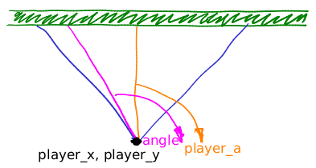

## TinyWorld
**This is my take on the project https://github.com/ssloy/tinyraycaster**
**This repo is to document my learning for the future**
# Blurt
I came across the tiny raycaster project from an instagram real and was really intreged by it
after taking a look at the project and deciding that I could probably do this somewhat with my 
current background on vectors and python I decided to try it.
There were some struggles and some logic that was hard to wrap my head around but thanks to claude that got sorted and explained
This was also my first time really using pygame. Im pretty sure I have used it in the past in my past learning attempts to
code in middle school but never really went anywhere with it.
The vector math made sense as I just finished that up in physics.
One of the biggest challenges my was probably wrapping my head around the math to draw the liens
eventually it clicked better.

# Project Structure
Feel free to take a look at the project and code.  
Im pretty happy with it but still want to improve it.

**To run the code make sure you have uv installed**  
**If you do not have it yet install with these:**

 **macOS/Linux**

    curl -LsSf https://astral.sh | sh

**Windows**

    powershell -c "irm https://astral.sh | iex"

**Next steps are to clone the repo**

    git clone https://github.com/RicePollution/tinyworld
    cd tinyworld

**Finally run the program!**
    
    uv run main.py

**Changing wall textures:**  
To change the wall textures go into main.py  
Then locate the wall_tex near pygame.init()  
It should look like this:

    wall_tex = pygame.image.load("textures/wall_textures/wall_03_64.png").convert()

All textures are located in the textures directory

# Other thoughts
**Fish Eye Correction**  
Another intresting thing I thought was the fisheye correction.  
Its very simple yet very intuitive  
  
(image from tinyraycaster wiki)

    dist = c*cos(ray_a-player_a)

This is then fed into the height calculation for the bar heights. Cool imo
